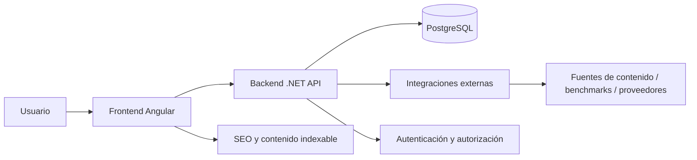
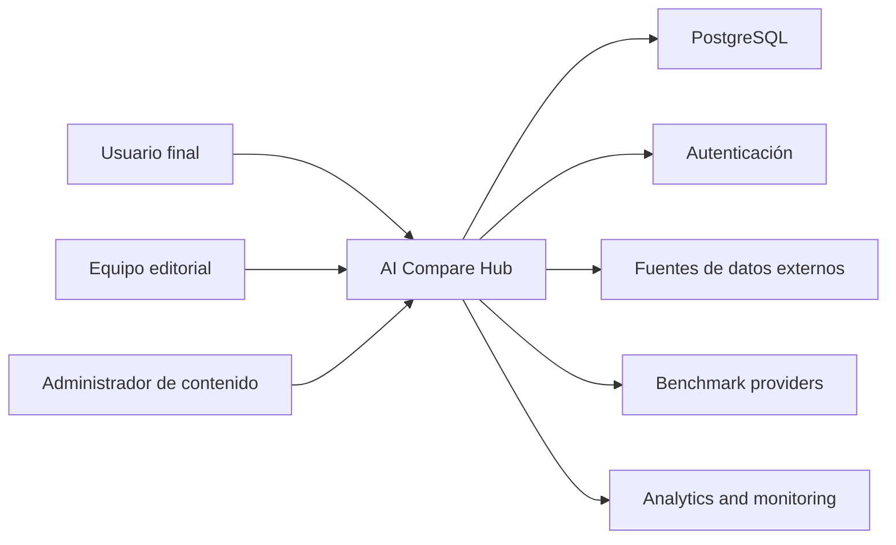

# System Design

## 1. Architectural Overview

AI Compare Hub será una plataforma web basada en arquitectura modular, orientada a frontend moderno y backend seguro, con separaciones bien definidas entre experiencia de usuario, lógica de negocio, datos y servicios externos.

La solución se compone de:

- Frontend web en Angular con Signals y componentes standalone.
- API backend en .NET para lógica de negocio, autenticación, catálogo y comparativa.
- Base de datos PostgreSQL para persistencia estructurada.
- Servicios de integraciones externas para contenido, benchmarks y metadatos.
- Capa de presentación y SEO orientada a contenido descubible.

## 2. High-Level Architecture

El sistema seguirá un patrón de arquitectura basada en capas con un dominio claro y un enfoque en modularidad, seguridad y escalabilidad.

## 3. Architectural Principles

- Separación clara entre frontend, backend y datos.
- Diseño orientado al dominio y a la comparación funcional.
- Seguridad por defecto con validación de entrada y controles de acceso.
- Reutilización de metadata y modelos de comparación.
- Escalabilidad basada en contenido y servicios externos.
- Transparencia en información factual, estimación y recomendación.

## 4. Context Diagram

El sistema interactúa con varios actores y ecosistemas externos.

### Context actors

- Usuario final: busca comparar y elegir herramientas IA.
- Equipo editorial: valida contenido y metadata.
- Administrador: gestiona catálogo y reglas de contenido.
- Proveedores externos: fuentes de benchmarks, contenido y métricas.

## 5. Frontend Architecture

### Tecnología

- Angular
- Signals
- Standalone Components
- SCSS
- Enfoque de arquitectura modular por feature y secciones de producto

### Design principles

- La interfaz debe priorizar rapidez de descubrimiento y claridad comparativa.
- Los componentes deben estar desacoplados por responsabilidad: catálogo, detalle, comparación, perfiles y recomendación.
- El sistema de estado debe seguir un modelo predictable y orientado al usuario.
- La navegación debe ser simple, consistente y accesible.

### Frontend responsibilities

- Renderizado de catálogo y filtros.
- Interacción con comparativa por herramientas.
- Presentación de benchmark y capacidad.
- Recomendaciones para perfil de usuario.
- Gestión de estado de sesión, navegación y comparativa.

### Frontend quality attributes

- Rendimiento de navegación y carga de listas.
- Accesibilidad para teclado y lectores.
- Responsividad para desktop y tablet.
- SEO-friendly rendering for public content.

## 6. Backend Architecture

### Capa de API

La API debe estar diseñada como un backend orientado a servicio para la lógica de dominio y la orquestación del contenido.

### Responsibilities

- Gestión de catálogo de herramientas.
- Carga y validación de metadata y capacidades.
- Comparación con definiciones de atributos y requisitos.
- Recomendaciones a partir del perfil del usuario.
- Seguridad y control de acceso.
- Integración de fuentes externas y normalización de datos.

### Domain services

- ToolCatalogService
- ComparisonService
- RecommendationService
- BenchmarkService
- UserProfileService
- ContentValidationService

### Quality goals

- La lógica de negocio debe separarse de la lógica de presentación.
- Los servicios deben ser reutilizables entre múltiples vistas del producto.
- La API debe soportar contenido estático y dinámico con trazabilidad clara.

## 7. Database Architecture

### Core data model

PostgreSQL será la base de datos principal para soportar el producto y mantener integridad relacional.

### Data domains

- User and user profiles
- Tool catalog
- Categories and capabilities
- Pricing plans
- Benchmarks
- Comparison sessions
- Recommendations
- Content validation metadata

### Database principles

- Normalización de entidades base.
- Relaciones explícitas entre herramienta, categoría y capacidad.
- Persistencia de metadata y fuentes de validación.
- Soporte de consultas analíticas y de catálogo con control de complejidad.

### Example data relationships

- Tool to Category: many-to-many
- Tool to Capability: one-to-many
- Tool to PricingPlan: one-to-many
- Tool to Benchmark: one-to-many
- User to Profile: one-to-many
- User to ComparisonSession: one-to-many

## 8. External Integrations

### Integrations required

- Sources of tool metadata and product information
- Benchmark sources or editorial datasets
- Authentication providers when applicable
- Analytics and monitoring tools
- Storage or CDN for media assets if required

### Integration guidelines

- External data must be normalized before entering the product model.
- Sources must be traceable, versioned and tagged when used in comparisons.
- Benchmarks must be labeled as editorial, estimated or external.
- Failures in external systems must not break the experience of core catalog browsing.

## 9. Security Architecture

- Autenticación para usuario identificado
- Autorización por roles y perfil
- Validación de entrada en frontend y backend
- Protección de contenido sensible o privado
- Logging seguro y trazabilidad básica

## 10. Operational Considerations

- Observabilidad centralizada para errores, latencia y consumo de API
- Registro de cambios editoriales para catálogo y benchmarks
- Monitoreo de disponibilidad y salud de integraciones externas
- Backups y recuperación de base de datos

## 11. Architectural Risks

- Desactualización del contenido si la validación editorial no está definida.
- Duplicación o inconsistencias entre fuentes externas y contenido local.
- Comparabilidad pobre si los atributos no están estandarizados.
- Recomendaciones poco fiables si el perfil del usuario no está bien definido.

## 12. Design Decision Summary

La arquitectura propuesta prioriza claridad de dominio, modularidad, confiabilidad y una experiencia de comparación útil. No se construye como un producto puramente analítico, sino como un portal de decisión que combina contenido estructurado, reconocimiento de valor y recomendación relevante.
