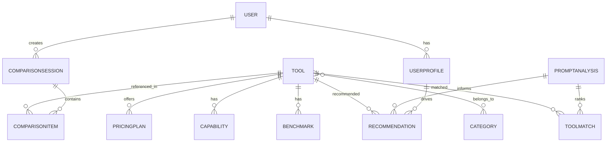

# Domain Model

## 1. Overview

El modelo de dominio de AI Compare Hub representa los conceptos esenciales que permiten catalogar, comparar y recomendar herramientas de IA. El dominio se centra en tres pilares: herramientas, usuarios y comparativas.

## 2. Domain Entities

### 2.1 User
Representa a cualquier persona que usa la plataforma para descubrir o comparar herramientas IA.

Atributos principales:
- userId
- displayName
- email
- profileType
- experienceLevel
- preferredCategories
- goals
- createdAt
- updatedAt

Relaciones:
- Un usuario puede crear uno o varios perfiles de uso.
- Un usuario puede guardar comparativas.
- Un usuario puede recibir recomendaciones personalizadas.

### 2.2 UserProfile
Representa la intención y contexto del usuario dentro del sistema.

Atributos principales:
- profileId
- userId
- goal
- role
- budgetRange
- preferredUseCases
- skillLevel
- constraints

Relaciones:
- Cada User tiene uno o varios perfiles de uso.
- Un perfil alimenta el motor de recomendación.

### 2.3 Tool
Representa una herramienta IA incluida en el catálogo.

Atributos principales:
- toolId
- name
- provider
- description
- status
- categories
- decisionAxes (capacidad, coste relativo, latencia, privacidad/despliegue, contexto y procedencia)
- releaseDate
- website
- updatedAt

Relaciones:
- Una herramienta pertenece a una o varias categorías.
- Una herramienta tiene varias capacidades.
- Una herramienta puede ofrecer varios planes de precios.
- Una herramienta tiene múltiples benchmarks o evaluaciones.
- Los ejes sin metadata se consideran desconocidos; los perfiles editoriales no sustituyen benchmarks verificables.

### 2.4 Category
Representa la clasificación funcional de una herramienta.

Atributos principales:
- categoryId
- name
- parentCategoryId
- description

Relaciones:
- Una categoría puede contener subcategorías.
- Muchas herramientas pueden pertenecer a la misma categoría.

### 2.5 Capability
Representa la competencia funcional de una herramienta.

Atributos principales:
- capabilityId
- name
- description
- categoryId

Relaciones:
- Una herramienta ofrece múltiples capacidades.
- Una capacidad se evalúa dentro de una categoría o caso de uso.

### 2.6 PricingPlan
Representa el modelo comercial asociado a una herramienta.

Atributos principales:
- pricingPlanId
- toolId
- planName
- pricingModel
- priceAmount
- currency
- billingCycle
- limitations

Relaciones:
- Una herramienta puede tener varios planes de precios.
- Un plan de precios puede asociarse a un caso de uso específico.

### 2.7 Benchmark
Representa una evaluación comparativa de la herramienta.

Atributos principales:
- benchmarkId
- toolId
- benchmarkType
- metricName
- score
- unit
- source
- evaluatedAt

Relaciones:
- Una herramienta puede tener varios benchmark records o evaluaciones.
- Los benchmarks alimentan la comparación y la recomendación.

### 2.8 ComparisonSession
Representa una selección de herramientas que un usuario quiere comparar.

Atributos principales:
- comparisonSessionId
- userId
- createdAt
- title
- status

Relaciones:
- Una sesión puede incluir varias herramientas.
- Una sesión genera un resumen comparativo.

### 2.9 ComparisonItem
Representa cada herramienta incluida dentro de una sesión comparativa.

Atributos principales:
- comparisonItemId
- comparisonSessionId
- toolId
- position
- notes

Relaciones:
- Cada item pertenece a una comparison session.
- Un tool puede aparecer en múltiples comparison sessions.

### 2.10 Recommendation
Representa la sugerencia de herramienta o conjunto de herramientas según el perfil del usuario o la intención de un prompt.

Atributos principales:
- recommendationId
- userId
- generatedAt
- reason
- confidenceScore
- recommendedToolIds

Relaciones:
- Una recomendación se genera desde un UserProfile o un PromptAnalysis y un conjunto de herramientas.
- Puede estar asociada a un caso de uso específico.

### 2.11 PromptAnalysis
Representa el resumen temporal de intención, tarea y restricciones relevantes extraídas de un prompt para orientar una recomendación.

Atributos principales:
- intent
- taskType
- requirements
- constraints
- analyzedAt

Relaciones:
- Una PromptAnalysis genera una recomendación contextual.
- El texto original del prompt no se conserva después de la consulta sin consentimiento explícito.

### 2.12 ToolMatch
Representa la adecuación de una herramienta del catálogo a los requisitos identificados en una PromptAnalysis.

Atributos principales:
- toolId
- fitScore
- rationale
- tradeoffs
- confidence
- evidenceReferences

Relaciones:
- Cada ToolMatch pertenece a una PromptAnalysis.
- Cada ToolMatch referencia una herramienta registrada en el catálogo.

## 3. Relationships

### Principales asociaciones

- User 1..* UserProfile
- User 1..* ComparisonSession
- ComparisonSession 1..* ComparisonItem
- Tool 1..* PricingPlan
- Tool 1..* Capability
- Tool 1..* Benchmark
- Tool *..* Category
- UserProfile *..* Tool (a través de recomendación)

## 4. Entity Relationship Summary

## 5. Ubiquitous Language

El lenguaje ubicuo del dominio debe usarse de manera consistente en toda la plataforma y en la documentación de negocio:

- herramienta
- categoría
- capacidad
- precio
- benchmark
- comparación
- perfil
- recomendación
- prompt
- intención de tarea
- adecuación de herramienta
- caso de uso
- comparación por objetivo

## 6. Business Rules

- Cada herramienta debe pertenecer al menos a una categoría principal.
- Cada comparación debe contener un mínimo de dos herramientas para ser válida.
- Cada perfil de usuario debe incluir un objetivo principal o caso de uso base.
- El contenido de benchmark debe estar asociado a una fuente o fecha de validación.
- Los metadatos de coste, latencia, privacidad y contexto deben declarar su procedencia y fecha cuando se conozcan.
- Los valores ausentes no se infieren a partir del score global de la herramienta.
- Las recomendaciones deben distinguir claramente entre sugerencia y valor absoluto.
- El análisis de prompt solo orienta la selección; no ejecuta el prompt contra las herramientas recomendadas.
- El prompt original es efímero por defecto y no se comparte con proveedores sin consentimiento explícito.

## 7. Domain Boundaries

El dominio excluye de esta especificación:

- comercio transaccional
- pagos directos dentro del sistema
- integración de compra de licencias desde la plataforma
- trabajo de administración de la herramienta por parte del usuario final

El núcleo del dominio es la comparación contextual y la recomendación de valor, no la operación comercial de los proveedores.
